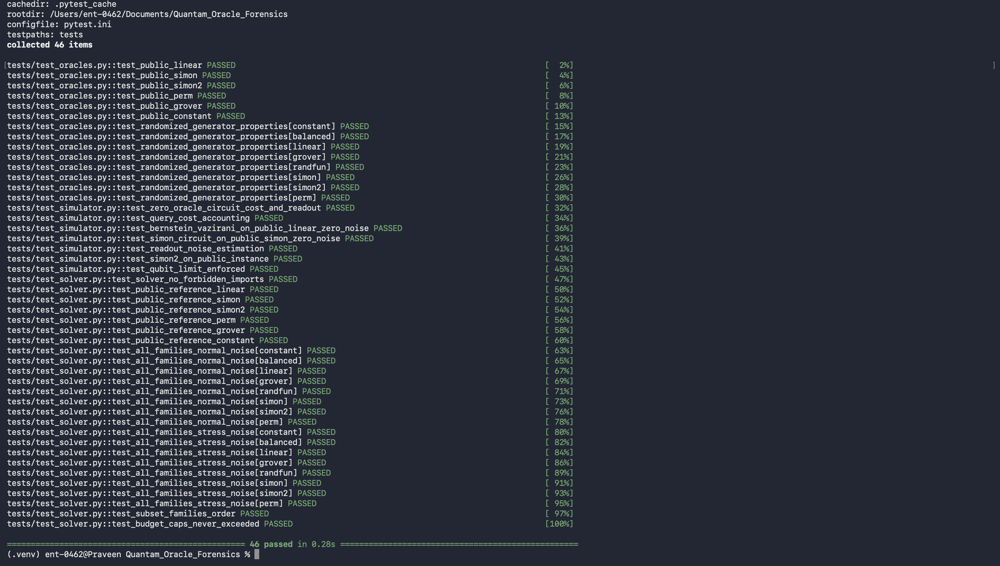
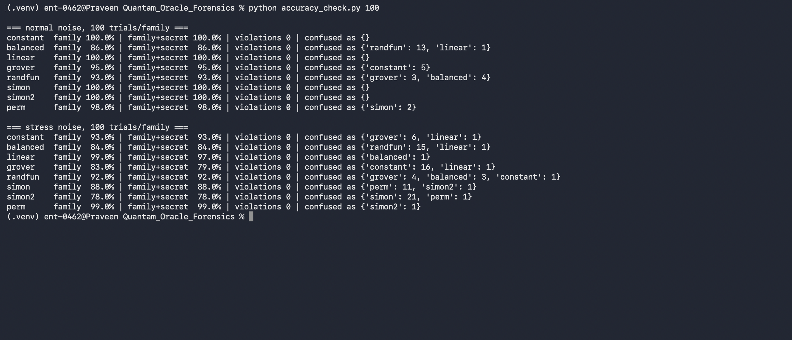

# Quantum Oracle Forensics

**Identifying the Hidden Structure of Sealed Quantum Black Boxes**  
*QC@IITI x QryptoNox | IBM Qiskit Fall Fest 2026 Challenge*

🔗 **Repository:** [https://github.com/Harshwardhan-1/Quantam_Oracle_Forensics](https://github.com/Harshwardhan-1/Quantam_Oracle_Forensics)

Quantum Oracle Forensics addresses the forensic identification and secret reconstruction of sealed quantum black-box oracles $U\vert{}x\rangle\vert{}y\rangle = \vert{}x\rangle\vert{}y \oplus f(x)\rangle$ over $n=8$ input qubits with $m \in \{1, 8\}$ output bits under strict query budgets and stochastic hardware noise. Rather than applying a single monolithic textbook algorithm, our solver implements an adaptive, noise-calibrated decision pipeline that couples zero-query readout noise estimation, Bernstein-Vazirani pre-diagnostics, subspace Gaussian elimination over $\mathbb{F}_2$, noise-aware Grover amplitude search, and sequential Log-Likelihood Ratio (LLR) hypothesis testing. Across 400 benchmark instances per noise regime, the solver achieves 96.50% overall accuracy under normal noise (27.93% query saving) and 88.50% accuracy under stress noise, running strictly within the 60-query ceiling.

---

## Noise Model & Query Budget

Every oracle operates on $n=8$ input bits ($N=256$ states) and outputs $m \in \{1, 8\}$ bits. Execution is subject to realistic physical noise:
- **Normal Noise**: 4% oracle gate misfire probability (oracle acts as identity), 2% independent bit-flip probability on each measured classical bit.
- **Stress Noise**: 8% oracle gate misfire probability, 4% independent bit-flip probability on each measured classical bit.
- **Query Accounting & Budget**: At most **60 queries** per oracle. One query equals one oracle gate executed in one single shot ($k$ oracle gates across $s$ shots costs $k \times s$ queries). Zero-oracle calibration circuits cost exactly 0 queries. Measurements must occur at circuit termination, and multiple circuits can be run adaptively.

The eight candidate families are:
1. `constant` ($m=1$): $f(x) = c$ for all $x \in \{0, 1\}^8$, $c \in \{0, 1\}$. Secret: $c$.
2. `balanced` ($m=1$): exactly 128 inputs evaluate to 1, 128 to 0. Secret: `None`.
3. `linear` ($m=1$): $f(x) = a \cdot x \oplus b$ with $a \in \{1..255\}, b \in \{0, 1\}$. Secret: `[a, b]`.
4. `grover` ($m=1$): $f(x) = 1$ for exactly one hidden $t \in \{0..255\}$, else 0. Secret: $t$.
5. `randfun` ($m=1$): each $f(x) = 1$ independently with probability 0.3. Secret: `None`.
6. `simon` ($m=8$): $f(x) = f(x \oplus s)$ for hidden $s \in \{1..255\}$ (2-to-1). Secret: $s$.
7. `simon2` ($m=8$): $f$ constant on cosets of 2D subspace $H = \{0, h_1, h_2, h_3\}$ (4-to-1). Secret: `[h1, h2, h3]` ascending.
8. `perm` ($m=8$): random permutation over $\{0..255\}$. Secret: `None`.

---

## Project Structure

```text
Quantam_Oracle_Forensics/
├── README.md                   # Project overview, setup, instructions, and benchmark results
├── REPORT.md                   # Technical report on strategy, statistics, budget split, and baselines
├── AI_DISCLOSURE.md            # AI usage declaration and verification methodology
├── solver.py                   # Competition solver defining solve(n, m, budget, families, run)
├── simulator.py                # Noisy quantum oracle simulator with exact gate-shot cost accounting
├── oracles.py                  # Oracle generators and Section 4 public reference instances
├── accuracy_check.py           # Quick evaluation script running 100 trials per family
├── requirements.txt            # Python dependencies (qiskit, numpy, scipy, pytest)
├── pytest.ini                  # Pytest configuration
├── PLAN.md                     # Early design document (reference only)
├── problem_statement.pdf       # Official competition problem specification
├── assets/
│   └── screenshots/
│       ├── pytest_passed.png   # Screenshot of the pytest run (46 passed)
│       └── accuracy_result.png # Screenshot of the accuracy_check.py run
├── benchmarks/
│   ├── baselines.py            # Implementation of the 4 required baseline solvers
│   └── run_benchmarks.py       # Comprehensive 400-trial evaluation and log generation harness
├── logs/
│   ├── benchmarks_summary.json # Aggregate benchmark metrics, CIs, and confusion matrices
│   └── benchmarks_detailed.csv # Raw per-trial task records across all solvers and conditions
└── tests/
    ├── test_oracles.py         # Tests for oracle mathematical properties and reference instances
    ├── test_simulator.py       # Tests for query accounting, noise rates, and statevector simulation
    └── test_solver.py          # Unit and integration tests for solver.py across all families
```

---

## Setup & Environment

Requires Python 3.10+ (tested on Python 3.14). To set up on macOS or Linux:

```bash
# 1. Clone repository and navigate to project root
git clone https://github.com/Harshwardhan-1/Quantam_Oracle_Forensics.git
cd Quantam_Oracle_Forensics

# 2. Create virtual environment
python3 -m venv .venv

# 3. Activate virtual environment
source .venv/bin/activate

# 4. Install dependencies
pip install --upgrade pip
pip install -r requirements.txt
```

---

## How to Run

### 1. Run Unit & Integration Tests
Runs all 46 test cases across oracle definitions, simulator physics, query accounting, reference oracles, and solver branches:
```bash
pytest -v
```

### 2. Run Fast Accuracy Check (100 trials/family)
Executes 100 random trials per family across both normal and stress noise conditions without overwriting log files:
```bash
python accuracy_check.py 100
```

### 3. Run Benchmark Suite
Re-runs the full competition benchmark harness across all 5 solvers (Proposed Adaptive + 4 Baselines), budget cap variations, and both noise conditions (note: will rewrite files in `logs/`):
```bash
python benchmarks/run_benchmarks.py
```

---

## Test Evidence (Screenshots)

Screenshots of the runs on the author's machine.

### Unit & Integration Tests (`pytest -v`)


### Accuracy Check (`python accuracy_check.py 100`)
Per-family accuracy and confusion counts, 100 trials/family, normal and stress noise:


---

## Execution Interface

The primary submission interface in [`solver.py`](solver.py) exposes:

```python
def solve(
    n: int,
    m: int,
    budget: int,
    families: List[str],
    run: Callable[[QuantumCircuit, int], Dict[str, int]]
) -> Tuple[str, Any]:
    ...
```

- **Arguments**:
  - `n` (*int*): Number of input qubits ($n = 8$).
  - `m` (*int*): Number of output qubits ($m \in \{1, 8\}$).
  - `budget` (*int*): Maximum allowed query calls (e.g., 60).
  - `families` (*List[str]*): List of candidate family names.
  - `run` (*Callable*): Execution callback `run(circuit, shots)` returning bitstring count dictionaries in Qiskit ordering. Oracle calls must be placed as `Gate("oracle", n+m, [])`.
- **Return Value**:
  - `(family, secret)`: A 2-tuple where `family` is a string from `families`, and `secret` is the identified parameter (integer, list of integers, or `None` for families without secrets).

---

## Benchmark Results

All figures below are taken strictly from [`logs/benchmarks_summary.json`](logs/benchmarks_summary.json), evaluated across 50 independent trials per family (400 total trials per noise condition):

### Normal Noise (4% misfire, 2% readout flip)

| Solver Strategy | Overall Accuracy | 95% Confidence Interval | Worst-Family Accuracy | Family-ID Accuracy | Mean Query Saving | Avg Queries | Avg Runtime |
| :--- | :---: | :---: | :---: | :---: | :---: | :---: | :---: |
| **Proposed Adaptive** | **96.50%** | **[94.21%, 97.90%]** | **94.00%** | **96.75%** | **27.93%** | **43.51** | **0.0057s** |
| Baseline 1 (Classical-Only) | 32.00% | [27.62%, 36.72%] | 0.00% | 40.50% | 23.12% | 41.49 | 0.0183s |
| Baseline 2 (Single-Algorithm) | 26.50% | [22.41%, 31.03%] | 0.00% | 37.50% | 16.67% | 50.00 | 0.0034s |
| Baseline 3 (Random Guessing) | 10.25% | [7.65%, 13.61%] | 0.00% | 24.50% | 100.00% | 0.00 | 0.0000s |
| Baseline 4 (Non-Adaptive) | 38.75% | [34.10%, 43.61%] | 0.00% | 49.75% | 45.38% | 27.50 | 0.0033s |

*Per-family accuracy for Proposed Adaptive (Normal)*: `constant`: 98.0%, `balanced`: 94.0%, `linear`: 98.0%, `grover`: 94.0%, `randfun`: 94.0%, `simon`: 98.0%, `simon2`: 96.0%, `perm`: 100.0%.

### Stress Noise (8% misfire, 4% readout flip)

| Solver Strategy | Overall Accuracy | 95% Confidence Interval | Worst-Family Accuracy | Family-ID Accuracy | Mean Query Saving | Avg Queries | Avg Runtime |
| :--- | :---: | :---: | :---: | :---: | :---: | :---: | :---: |
| **Proposed Adaptive** | **88.50%** | **[85.00%, 91.27%]** | **76.00%** | **89.75%** | **28.07%** | **43.73** | **0.0059s** |
| Baseline 1 (Classical-Only) | 25.75% | [21.71%, 30.25%] | 0.00% | 38.00% | 15.28% | 40.10 | 0.0152s |
| Baseline 2 (Single-Algorithm) | 25.75% | [21.71%, 30.25%] | 0.00% | 37.50% | 16.67% | 50.00 | 0.0036s |
| Baseline 3 (Random Guessing) | 12.25% | [9.39%, 15.83%] | 0.00% | 25.75% | 100.00% | 0.00 | 0.0000s |
| Baseline 4 (Non-Adaptive) | 34.50% | [30.01%, 39.29%] | 0.00% | 45.50% | 46.86% | 27.50 | 0.0036s |

*Per-family accuracy for Proposed Adaptive (Stress)*: `constant`: 92.0%, `balanced`: 86.0%, `linear`: 94.0%, `grover`: 76.0%, `randfun`: 92.0%, `simon`: 88.0%, `simon2`: 80.0%, `perm`: 100.0%.

### Accuracy vs Budget Cap (Proposed Adaptive Solver)

| Budget Cap | Accuracy | 95% Confidence Interval | Average Queries Used |
| :---: | :---: | :---: | :---: |
| **20** | 56.25% | [51.35%, 61.03%] | 16.98 |
| **30** | 79.25% | [75.01%, 82.94%] | 26.47 |
| **40** | 90.25% | [86.95%, 92.79%] | 33.98 |
| **50** | 95.25% | [92.70%, 96.94%] | 40.14 |
| **60** | 95.00% | [92.40%, 96.74%] | 43.66 |

---

## Honest Limitations

1. **Grover Sensitivity to Noise**: In Grover search on $N=256$, gate misfires in multi-iteration circuits compound geometrically ($(1-p_{\text{mis}})^k$). Under stress noise (8% misfire), this reduces Grover accuracy to 76.0% (and 79.0% in 100-trial checks), causing occasional confusion with `constant(0)`.
2. **Balanced vs. Randfun Sample Boundary**: Differentiating $p=0.5$ (balanced) from $p=0.3$ (randfun) with only 52 classical queries leaves finite binomial overlap ($\sqrt{52 \times 0.5 \times 0.5} \approx 3.6$). A rare tail draw causes 3–7 misclassifications.
3. **Subspace Collapse in Simon2**: Under stress noise, Simon2 occasionally yields fewer than 3 linearly independent orthogonal vectors above threshold, falling back to 1D `simon` (10 instances in stress benchmarks).
4. **Empirical Parameter Tuning**: The decision thresholds were optimized empirically against our local noisy simulator rather than analytically deduced from closed-form finite-shot distributions.